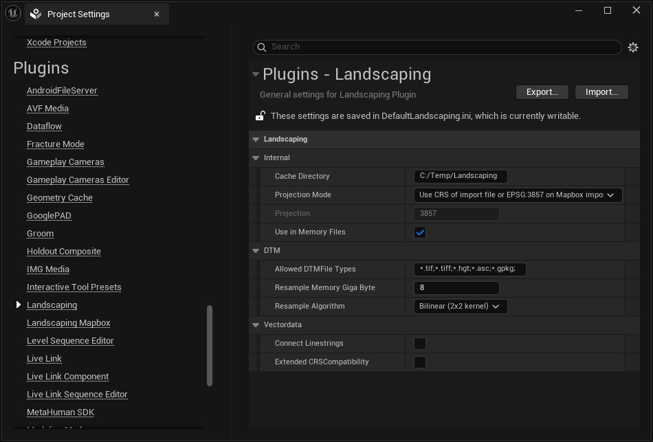

# Settings

Landscaping System does provide settings which are saved per project and can be found in `Project Settings -> Plugins -> Landscaping`.  
For settings of __Landscaping Mapbox__ see [Landscaping Mapbox](mapbox.md?id=settings)  

  

## Internal

### Cache Directory

When importing heightdata (DTM files), intermediate files are generated. They are necessary to circumvent the 2 GB import restriction from Unreal Engine. Please make sure it is set to a writable directory. The plugin will try to create the directory, if it does not exist already.

> The Cache Directory defaults to `C:/Temp/Landscaping` on Windows and `/tmp/Landscaping_Cache` on Linux and MacOS.

### Projection Mode

Projection mode for imported geospatial data. This should be set before importing any data and never changed when working on a map.

> All data must have a CRS with unit meter. If the CRS has unit degree, the projection mode has to be set to `Automatically reproject to appropriate UTM CRS`

#### Automatically reproject to appropriate UTM CRS

UTM CRS (Coordinate Reference System) will be determined by the first imported heightmap or shapefile. On Mapbox Imports this will be EPSG:3857. All imported data will then be reprojected to the determined CRS.

#### Use CRS of import file or EPSG:3857 on Mapbox import

Import data will not be reprojected to UTM, but the heightmap's or shapefile's CRS will be used. All data imported afterwards will be reprojected to this CRS. Please make sure that the imported data is in meter to get the real scale.

#### Use custom CRS specified below

Reproject imported data to the CRS specified under `Projection`.

### Projection

EPSG code of target CRS to use when importing height data.  
E.g. 3395 for Mercator WGS84.  

> IMPORTANT: only easting/northing CRS with unit meter will work. If using feet, the `Landscape Scale Factor` has to be set accordingly - see [Scale](landscapinginfos.md?id=scale).

### Use in Memory Files

Only create intermediate files in memory and not on disk. This will lead to faster imports. Uncheck this, if you want to use intermediate files in other applications.

## DTM

### Allowed DTM File Types

Filetypes recognized for importing DTM files. Defaults to `*.tif;*.tiff;*.hgt;*.asc;*.gpkg;`. See also [LandscapingInfos](landscapinginfos.md?id=allowed-dtm-file-types) for more information.

### Resample Memory Giga Byte

The amount of RAM reserved for resampling raster data. Higher values lead to faster resampling.  

### Resample Algorithm

Which algrithm to use for resampling raster data. Bilinear is default and does provide the best output.  

  

## Vectordata

### Allowed Vector File Types

File extensions recognized for vector imports, for both `VECTOR` and `LANDUSE`. Defaults to `*.shp;*.json;*.geojson;*.geojsonl;*.geojsons;*.osm;*.osm.pbf;*.gpkg;`.

Shapefile, GeoJSON and GeoPackage are handled by the same reader, so the same data in any of the three formats produces the same result. OSM files are read for vector geometry only and cannot be used as landuse input.

### Connect Linestrings

Vector data with linestrings to create e.g. spline-based roads or rivers can be auto-connected. The linestrings are connected by name.  
Set this to `true`, if there are segmented non-branching roads or rivers.  
Set it to `false` (default), if there are branches.  
The following map shows a branching river (Tiefenbach) - here linestrings cannot be connected in an meaningful way - therefore the value should be set to `false`. This will result in one spline per river branch.  

### Extended CRS Compatibility

Off by default. Turns on a multi-step conversion for vector data that cannot be converted to the Level CRS in one step.

Normally a vector file is reprojected directly into the Level CRS. When that single conversion fails, shapes that should be inside the Landscapes are not found, and the import reports that no tile received data even though the file clearly overlaps. Enabling this setting retries through an intermediate CRS instead.

Turn it on when:

- vector features are missing although the file overlaps the Landscapes,
- the Output Log reports a failed or dropped reprojection,
- the source CRS and the Level CRS do not share a datum or a region where a direct conversion exists.

Leave it off otherwise. The extra conversion pass makes vector imports noticeably slower, and the direct path already handles the common cases.

> ❗ IMPORTANT: this affects vector data only. A DTM or satellite image that does not import is a Projection Mode problem, not something this setting will fix. ❗

## Coordinate reference systems

A Level works in a projected CRS whose unit is metre. Two things follow from that:

- **Degrees are not usable.** A geographic CRS such as EPSG:4326 has to be reprojected, otherwise the coordinates are meaningless as Landscape positions.
- **Feet are not usable either.** A projected CRS in feet imports at the wrong scale unless `Landscape Scale Factor` compensates for it, see [Scale](landscapinginfos.md?id=scale).

### What the plugin accepts

`Projection` is validated by asking PROJ whether the code exists, not by comparing it against a numeric range. A valid low code such as `4326` is therefore not rejected for being small, and an unknown code is not silently accepted as though it were real.

As a Level CRS:

| Input | Result |
| :--- | :--- |
| Projected, unit metre, EPSG code known | accepted, the code is reported |
| Projected, unit metre, no EPSG code but valid WKT | accepted, reported as `0` |
| Geographic, e.g. `4326` | refused |
| Projected but not in metre, e.g. US survey feet | refused |
| Code not known to PROJ | refused |

A refused CRS produces an actionable error that names the fix, rather than importing into the wrong place. The same error is returned through `error_message` when a script triggers it, so it does not have to be hunted for in the Output Log.

### When no EPSG code can be reported

Some projected CRS have a WKT that PROJ cannot match back to an EPSG code. `MGI / Austria Lambert` is one. Such a file is still accepted and reprojected correctly, because the full WKT is carried through and used for the conversion, but there is no code to report.

When a script reads `info.projection` it gets `0` in that case. A `0` means "not georeferenced, or georeferenced with a CRS that has no EPSG code", so it should not be read as a failure on its own - read `success` and `tiles_processed` for that.

To get a definite code for such data, reproject the source to a CRS that has one before importing, or set `Projection Mode` to `Use custom CRS` and name the target code yourself.

## Automation

### Allow Automation Writes

Allow scripted callers (Python, MCP) to run operations that modify the Level, such as importing files or creating terrain. Off by default.

Read only queries are always allowed. Nothing is ever saved automatically; saving stays an explicit request. Leave disabled unless you intend to drive this plugin from a script.

See [Automation](automation.md?id=automation) for the scripted API.

## Video

Youtube video where the settings are explained:  
